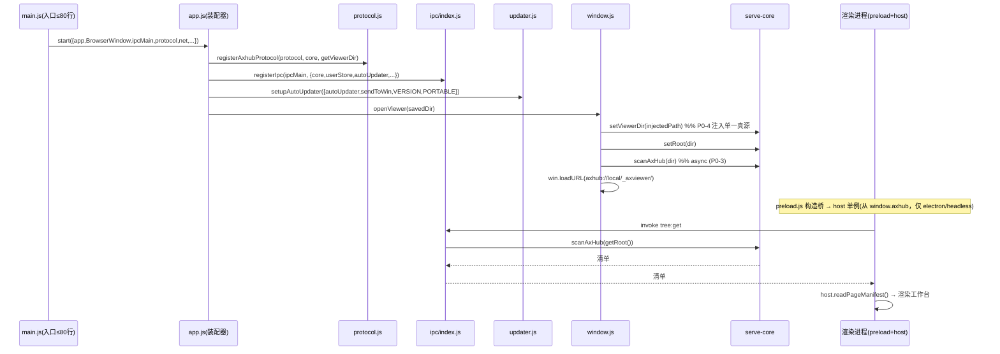
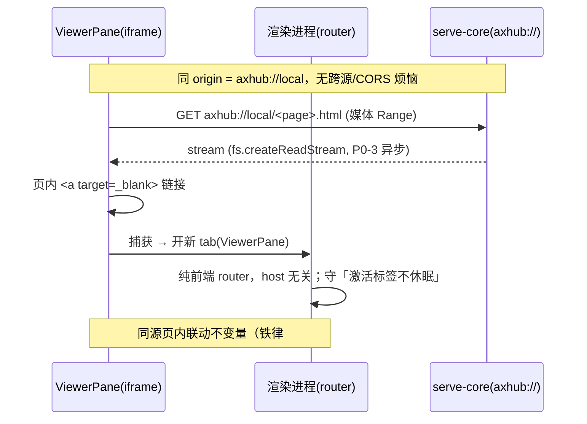
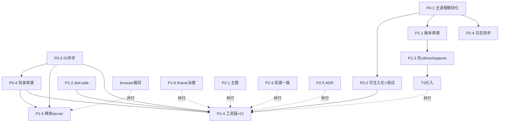

# AxHub 原型工作台 · 重构架构方案 + 任务分解（v2 · 用户决策修正版）

> 角色：架构师（高见远）基于 PM 许清楚的《重构 PRD》与代码库实证抽样产出，并按用户 4 项拍板决策修正。
> 配套：`.scratch/axhub-refactor/prd.md`；遵循既有 `.scratch/<feature>/spec.md` + `issues/*.md` 约定。
> 语言：中文。铁律 #1–#6 全程不得违反（见 PRD §0.2）。

## 〇、现状评估（代码库实证）

> 抽样方法：仅 Read/Grep 业务与测试文件，**不递归扫描 `node_modules`**。证据来自真实文件行号。

| 评估项 | 实证结论 | 证据位置 | 关联需求 |
|---|---|---|---|
| 主进程单体 | `main.js` 实测 473 行，单文件混装协议/更新/日志/托盘/IPC/生命周期 | `desktop/main.js` L23–473 | P0-1 |
| serve-core 同步 IO | `withContent` 用 `fs.openSync/readSync/closeSync`；`fileResponse`/`getViewerHtml`/`scanAxHub` 散用 `statSync/readSync/readdirSync` | `desktop/serve-core.js` L67,L75,L97,L103,L129,L134,L136,L213–214 | P0-3 |
| 查看器目录多路径探测 | `VIEWER_DIR` 4 处 fallback（`__dirname`/`resourcesPath`/`../`/`../../`/`cwd`） | `desktop/serve-core.js` L27–36 | P0-4 |
| SPI 已成熟守界 | `host/index.js` 单一出入口 + `makeHost` 强契约；conformance 含坏后端负向用例 + 接口纯净性 + 守界 grep；**当前三后端 electron/browser/headless** | `desktop/test/host-conformance.test.js` | 铁律#4 |
| 壳层/桥零测试 | `main.js`/`preload.js`/electron 后端真实 IPC 无用例 | `desktop/test/*.js`（9 个，无 main/preload/ipc 专项） | P0-2 |
| 构建 `cd` 化 + 双 package | `build:viewer` = `cd viewer && npm run build`；两套 `package.json` 两套 `npm install` | `desktop/package.json` L9；`desktop/viewer/package.json` | P1-3 |
| 打包三坑靠记忆 | `emptyOutDir:false` 写死 vite 配置；shim 注入/NSIS 缓存仅 README 文字 | `desktop/viewer/vite.config.js` L15 | P1-2 / 铁律#6 |
| 版本号三处人工 | `app.getVersion()`（来自 package.json）/ Release tag 人工一致 | `desktop/main.js` L66；`desktop/package.json` L3 | P1-1 |
| 零依赖本地服务 | `axhub-server.js` 纯 Node http 适配层 + CLI 入口，`module.exports` 暴露旧名字 | `desktop/axhub-server.js` L100–107 | P1-5 |
| lib/host 为 ESM `.js` | `viewer` 为 `type:module`；`lib/tabs.js` 等以 `export` 暴露，被 CJS 测试文件经 `await import()` 直测 | `desktop/viewer/src/lib/tabs.js` L1–15；`desktop/test/host-conformance.test.js` L15 | 铁律#5 / TS 化解 |

**评估结论**：主干（SPI + 纯逻辑 `lib/` + serve-core 宿主无关）健康成熟，本轮是深化治理。四大 P0（P0-1~P0-4）为工程治理，与 Electron/Vite 版本无关。

---

## 一、实现方案 + 框架选型

### 1.1 方案对比

| 维度 | **A. 维持不动（依赖版本冻结）** | **B. 同栈大版本升级** | **C. 换 React** |
|---|---|---|---|
| 内容 | 架构/测试/性能/目录治理 + **UI 引 TS** + **裁剪 browser 后端**；版本号冻结 | Electron→33/34、builder→25/26、Vue→3.5、Vite→6/7、antdv→4.3+、Node→20/22 | 推翻 Vue 改 React |
| 利 | 风险最低、回归面最小；100% 守铁律 #3/#4/#5（改写后） | 性能/安全收益、生态主流 | （无显著收益） |
| 弊 | Electron 30 EOL（但本地只读同源浏览器，风险低） | 升级踩坑高概率（见 §1.2）；需全量回归 | **与铁律 #3 冲突**；UI/组件/测试全推翻 |
| 对 P0 影响 | P0-1~P0-4 全部可在 A 栈内 100% 解决 | 同左，但须同步处理升级破窗 | 不可行 |

### 1.2 方案 B 升级踩坑清单（实证 + 预判，文档化待拍板后执行）

| # | 坑 | 现象 / 根因 | 应对（固化点） |
|---|---|---|---|
| B-K1 | `emptyOutDir` 绕过失效 | Vite 6/7 对 `emptyOutDir` 语义/默认调整；沙箱 shim 仍拦截清空 | `vite.config.ts` 升级后重新核对 |
| B-K2 | 沙箱 shim 注入污染产物 | `npm run dist` 须预清 `NODE_OPTIONS/CODEBUDDY_SESSION_ID/CLAUDE_SESSION_ID` | 固化进 `scripts/dist-safe.mjs` |
| B-K3 | NSIS `StdUtils::TestParameter` 缺失 | builder 升级后 `nsis-resources` 缓存版本不匹配 | `dist-safe` 内置缓存检测 + 重下 |
| B-K4 | Node 22 模块探测击穿 CJS 测试 | 探测把含 `import.meta` 的 `.js` 判成 ESM，`require()` 失效 | 升级后全量 `node --test` + `grep` 守门（限 `.js`） |
| B-K5 | electron-updater / builder 联动 | publish 字段、NSIS 宏、portable 目标变更 | 升级后手动走更新下载 + 安装 |
| B-K6 | antdv 4.3+ / Vue 3.5 破坏性 | 响应式内存优化、props 变动 | 回归 `viewer/src/components/**` + `composables/**` |

### 1.3 方案 B 回归计划

| 阶段 | 必跑项 | 门禁 |
|---|---|---|
| 静态守门 | `grep -rn "import\.meta" desktop/*.js desktop/test/*.js viewer/src/lib/*.js viewer/src/host/*.js`（应空） | CI 红则阻断 |
| 单元测试 | `cd desktop && node --test`（含 `host-conformance` 两后端 + 坏后端负向 + 守界 grep） | 全绿 |
| 构建 | `npm run build:viewer` → 检查 `viewer-dist` 无旧 hash 残留 | 产物比对 |
| 打包 | `npm run dist:safe` → 实测 NSIS + portable 双产物 | 双产物验证 |
| 手动冒烟 | 选目录→工作台、多标签、更新下载、关闭后台运行、便携版指引 | 功能清单 |

### 1.4 不推荐 C 的说明

C 直接违反**铁律 #3**「前端已是 Vue 工程」。当前 `viewer/` 已有 Pinia + vue-router + 71 项测试 + SPI + `lib/` 纯逻辑层，推翻等于重写。本轮不纳入候选。

### 1.5 取舍建议（架构师立场 · 已随用户拍板更新）

> **用户已就 Q1 拍板——先 A 后 B 分阶段**：本轮落地 **A 基线治理**（T1–T14 + 新增 **T15 UI 引 TS** + **T16 裁剪 browser 后端**），验收通过（见 §1.6 门槛）后，**单独冲刺 B**（B1–B5 升级 + 回归）。
> A 阶段 = 依赖版本冻结 + 架构治理 + UI 引 TS + browser 裁剪；B 阶段 = 仅做依赖大版本升级。

### 1.6 A → B 切换门槛（A 完成、可切 B 的验收口径）

| # | 门槛（全部满足才可启动 B） | 校验方式 |
|---|---|---|
| G1 | T1–T14 + T15(TS) + T16(browser 裁剪) 全部合并，CI 全绿 | CI 状态 |
| G2 | 铁律#4 守界：host-conformance（**electron+headless 两后端**）+ 坏后端/rogue 负向 + 守界 grep（`window.axhub`/`localStorage`）100% 通过 | `node --test` |
| G3 | P0 验收（PRD §6）：主进程单文件 ≤120 行、入口 ≤80 行；serve-core grep 无 `readSync/openSync/statSync`；VIEWER_DIR 无 fallback；壳层新增测试 ≥1 套全绿 | grep + 行数 |
| G4 | 性能：serve-core 异步化后压测单请求 P99 较同步基线下降可量化（记录基线→目标值） | 压测脚本 |
| G5 | 工程化：workspaces 单仓单 `npm install`；`build:viewer` 去 `cd` 成功产出 viewer-dist；`dist:safe` 一键可复现（NSIS+portable）；版本号三处一致校验通过 | 脚本 |
| G6 | TS 引入：UI 全转 TS、`vue-tsc --noEmit` 零类型错误；`@/` 别名 vite+tsconfig 双处一致；`lib/host` 仍 `.js` 且 `node --test` 全绿（含 conformance） | vue-tsc + node --test |
| G7 | 用户冒烟：选目录→工作台、多标签切换、更新下载进度、关闭后台运行、便携版指引 全部正常 | 手动清单 |

---

## 二、目录结构

### 2.1 主进程模块化拆分（P0-1）

`desktop/main.js` 从 473 行退化为 ≤80 行**纯装配入口**；逻辑下沉到 `desktop/src/`，单文件职责 ≤1 关注点（验收 ≤120 行/文件）。

```
desktop/
├── main.js                      # 入口装配，≤80 行：仅 require app + app.start()
├── src/
│   ├── app.js                   # 装配器：whenReady 编排 protocol/ipc/updater/tray/window/lifecycle
│   ├── protocol.js              # axhub:// 注册 + 适配器（core.handleRequest → web Response，异步）
│   ├── config.js                # loadConfig/saveConfig/loadDir/saveDir（注入式）
│   ├── logger.js                # log() 封装（P2-4 可异步化）+ 1MB 轮转
│   ├── window.js                # createWindow/openViewer/showMainWindow/handleClose
│   ├── tray.js                  # ensureTray/trayIconPath
│   ├── updater.js               # setupAutoUpdater（注入 ipcMain/sendToWin/getVersion/isPortable）
│   └── ipc/
│       ├── index.js             # registerIpc(ipcMain, deps) 聚合所有 handler 注册
│       ├── workspace.js         # picker:select / dir:clear / tree:get
│       ├── user-data.js         # user-data:load-sync / save / clear
│       ├── apidocs.js           # apidir:pickFiles / apidir:read
│       ├── update.js            # app:version / update:check / update:install / update:set-silent
│       └── close.js             # close:ask / close:apply / close:save
├── serve-core.js                # 宿主无关核心（异步化 + setViewerDir 注入，见 §三）
├── scan-shared.js               # 扫描单源（不变）
├── user-store.js / user-keys.js # 持久化单源（不变，保持 .js）
├── preload.js                   # 桥：抽 buildBridge(ipcRenderer, PREFIX) 纯函数（P0-2 可测，保持 .js）
├── scripts/
│   ├── bump-version.mjs         # P1-1：npm version 钩子，同步三处版本 + changelog
│   ├── release-check.mjs        # P1-1：校验 package.version === app.getVersion() === tag
│   └── dist-safe.mjs            # P1-2：跨平台清 env + nsis-resources 缓存检测 + electron-builder
└── test/                        # node --test（CJS 风格，禁用 import.meta，限 .js）
    ├── ipc.test.js              # 新增：registerIpc 纯函数注入 mock ipcMain 断言
    ├── preload.test.js          # 新增：mock ipcRenderer 验证 17 方法映射
    ├── main-smoke.test.js       # 新增：app.start 装配无异常（不真正起 Electron）
    └── ...（既有 9 个，含 host-conformance 改两后端）
```

> **TS 引入（决策 3）**：`viewer/` 升级为 TypeScript——新增 `viewer/tsconfig.json`、`viewer/vite.config.ts`（原 `.js` 改 `.ts`）、`src/main.ts` 及 `components/stores/composables/router` 全量 `.ts` / `<script setup lang="ts">`；`vue-tsc --noEmit` 做类型守门。但 **`viewer/src/lib` 与 `viewer/src/host` 保持 `.js` 不参与 TS 编译**（见 §六 新铁律#5），以零成本保留 `node --test` 直测与 conformance。

### 2.2 构建去 `cd` 化（P1-3，建议采纳 workspaces）+ TS 兼容性

`desktop/package.json` 增加 `"workspaces": ["viewer"]`，构建脚本改为不 `cd`：
```jsonc
"scripts": {
  "build:viewer": "npm run build --workspace viewer",   // 去 cd
  "start": "npm run build:viewer && electron .",
  "dist": "npm run build:viewer && electron-builder",
  "dist:safe": "node scripts/dist-safe.mjs",
  "version": "node scripts/bump-version.mjs",
  "release:check": "node scripts/release-check.mjs",
  "test": "node --test",
  "type-check": "npm run type-check --workspace viewer",  // 新增：vue-tsc --noEmit
  "lint": "eslint desktop/src preload.js",
  "format": "prettier --write ."
}
```
- 双 `npm install` → 单 `npm install`（根 workspaces 提升依赖）。
- `viewer/` 仍 `type: module`、`private: true`，独立 `vite build` 输出到 `../viewer-dist`，铁律 #3 边界不变。
- **与 TS 引入不冲突**：workspaces 仅提升依赖与统一脚本；`viewer/` 自带 `tsconfig.json` 与 `typescript` devDep，`build:viewer` 内部 `vue-tsc --noEmit && vite build`，`@/` 别名在 vite + tsconfig 双处声明；`lib/host` 保持 `.js` 不受 TS 编译影响。
- 若用户选「保持双 package」（Q4 备选），则改用 `scripts/build-viewer.mjs`（child_process 调 `npm --prefix viewer run build`），同样去 `cd`，但依赖不提升。

### 2.3 打包 / 版本脚本化目录

见 §2.1 `scripts/`。`dist:safe.mjs` 固化铁律 #6 三坑：
```js
// scripts/dist-safe.mjs（核心逻辑，跨平台）
process.env.NODE_OPTIONS = '';
delete process.env.CODEBUDDY_SESSION_ID;
delete process.env.CLAUDE_SESSION_ID;
// NSIS 缓存检测：缺失 StdUtils 宏时清缓存重下
const nsisCache = path.join(os.homedir(), 'AppData/Local/electron-builder/nsis-resources');
if (fs.existsSync(nsisCache) && !hasStdUtils(nsisCache)) fs.rmSync(nsisCache, { recursive: true, force: true });
await spawn('electron-builder', [], { stdio: 'inherit' });
```

---

## 三、数据结构与接口（模块边界 + 类图）

### 3.1 主进程模块边界（classDiagram）

```mermaid
classDiagram
    class App {
      +start(deps)
      -registerProtocol()
      -registerIpc()
      -setupUpdater()
      -openViewer()
      -lifecycle()
    }
    class ProtocolAdapter {
      +registerAxhubProtocol(protocol, core, getViewerDir)
    }
    class IpcRegistry {
      +registerIpc(ipcMain, deps)
    }
    class WorkspaceIpc { +register(ipcMain, core, window) }
    class UserDataIpc { +register(ipcMain, userStore) }
    class ApiDocsIpc { +register(ipcMain) }
    class UpdateIpc { +register(ipcMain, autoUpdater, sendToWin, VERSION, PORTABLE) }
    class CloseIpc { +register(ipcMain, config) }
    class Updater { +setupAutoUpdater(deps) }
    class Tray { +ensureTray() +trayIconPath() }
    class Logger { +log(...args) }
    class WindowMgr { +createWindow() +openViewer(d) +showMainWindow() +handleClose() }
    class Config { +loadConfig() +saveConfig(patch) +loadDir() +saveDir(d) }
    class ServeCore {
      +setViewerDir(dir)
      +getViewerDir()
      +setRoot(root)
      +getRoot()
      +handleRequest(opts)* async
      +scanAxHub(root)* async
      +fileResponse(...)* async
      +withContent(...)* async
      +getViewerHtml()* async
      +safeJoin(root, reqPath)
      +mimeOf(p)
    }
    App --> ProtocolAdapter
    App --> IpcRegistry
    App --> Updater
    App --> WindowMgr
    App --> Tray
    App --> Config
    IpcRegistry --> WorkspaceIpc
    IpcRegistry --> UserDataIpc
    IpcRegistry --> ApiDocsIpc
    IpcRegistry --> UpdateIpc
    IpcRegistry --> CloseIpc
    WindowMgr --> ServeCore
    ProtocolAdapter --> ServeCore
    note for ServeCore : * = P0-3 异步化；\nsetViewerDir 取代 4 处 fallback (P0-4)
```

### 3.2 serve-core 异步化后的接口签名（P0-3 + P0-4）

```js
// ---- P0-4：注入式单一真源，移除 4 处 fallback ----
function setViewerDir(dir) {                 // 必填注入，缺失即抛
  if (!dir) throw new Error('viewerDir 未注入：必须由主进程显式 setViewerDir');
  VIEWER_DIR = path.resolve(dir);
}
function getViewerDir() {
  if (!VIEWER_DIR) throw new Error('viewerDir 未注入');
  return VIEWER_DIR;
}

// ---- P0-3：全异步，fs.promises + 流式 ----
async function scanAxHub(root) {                 // 替代 readdirSync/statSync
  const entries = await fs.promises.readdir(root, { withFileTypes: true });
  for (const ent of entries) { /* ... */ const st = await fs.promises.stat(path.join(root, f)); }
}
async function fileResponse(method, full, status, allowOrigin, root) {
  const st = await fs.promises.stat(full);       // 替代 statSync
  return { status, headers, total, file: full, body: null, stream: null };
}
async function withContent(method, headers, r) {
  // Range：fs.createReadStream(r.file, { start, end }) → 流式，零 readSync
  // 全量：fs.createReadStream(r.file) → 流式
}
async function getViewerHtml() {                 // 替代 statSync/readFileSync/accessSync
  const st = await fs.promises.stat(f);
  if (changed) VIEWER_HTML = await fs.promises.readFile(f, 'utf8');
}
async function handleRequest(opts) {              // 返回含 stream 描述符；内部 await fileResponse
  /* 路由逻辑不变，静态分支 await fileResponse → withContent 返回 stream */
}
```

**契约保持**：`module.exports` 表面 (`setRoot/getRoot/handleRequest/scanAxHub/safeJoin/getViewerHtml/mimeOf`) 签名除「改异步」外不变；`VIEWER_DIR` 导出移除，改由 `getViewerDir()` 运行时取。适配器（`protocol.js` / `axhub-server.js`）改为 `await core.handleRequest(...)` 并消费 `r.stream`（HTTP 侧 `stream.pipe(res)`；协议侧 `net.fetch(file://)` 或 `Readable.toWeb`）。

### 3.3 host SPI 契约如何保持（铁律 #4，决策 2 修正）

- `viewer/src/host/index.js` **仍为唯一出入口**；**用户决策裁剪 browser 后端后，仅保留 `electron` + `headless` 两后端**（原三后端缺一≈假 SPI 的约束随 browser 移除而调整）。`makeHost` 三条契约（查询=Promise/命令=no-op/订阅=unsubscribe）与 `ALL_CAPABILITIES` 登记**不变**——契约与后端数量解耦。
- `host/index.js` 修正：
  - 删除 `import { createBrowserHost } from './browser.js'`。
  - `createHost(mode)` 的 map 移除 `'browser'`；自动探测兜底由 `return createBrowserHost()` 改为 `return createHeadlessHost()`（无壳无浏览器选择能力时降级到内存后端，而非错误）。
  - 注：electron 后端 `chooseWorkspace` 返回 `{name, pages:null}`（靠 reload 后 `readPageManifest` 供给）；headless 后端返回 `{name, pages}`（测试/内存）。二者均经同一 `makeHost` 契约。
- `stores/workspace.js#selectDirectory()` 分流简化：`if (sel.pages) { mergeTree } else { 依赖 reload/manifest }` 结构**保留**（headless 仍返回 pages 供测试），仅把注释「桌面壳为 null / 浏览器返回 pages」改为「桌面壳为 null、headless 内存后端返回 pages；browser 已裁剪」。
- P0-2 测试扩展：
  - `preload.js` 抽 `buildBridge(ipcRenderer, PREFIX)` 纯函数 → `test/preload.test.js` mock `ipcRenderer` 验证 17 方法映射。
  - `app.js#start` 注入 mock → `test/main-smoke.test.js` 断言协议注册 + 菜单装配无异常。
  - 既有 `host-conformance.test.js` **改为仅 electron + headless 两后端**：删除 browser 专项用例（`browser 后端按能力声明降级` 整段）、删除对 `browser.js` 的 `import`、负向用例（坏后端/rogue）与守界 grep 不变。

---

## 四、任务列表（核心产出 · 用户决策修正版）

> 组织原则：**基础任务（A 阶段必做）** 按依赖顺序先行（含用户拍板的 **T15 UI 引 TS** 与 **T16 裁剪 browser 后端**）；**B 专属任务** 仅拍板 B 后追加。每条含：任务名 / 涉及文件 / 前置依赖 / 验收标准（对齐 PRD §6）/ TS·裁剪影响。

### 4.1 基础任务（A 阶段，必做）

| ID | 优先级 | 任务名 | 涉及文件 | 依赖 | 验收标准 | TS/裁剪影响 |
|---|---|---|---|---|---|---|
| **T1** | P0-1 | 主进程模块化拆分 | `main.js`(≤80行)、`src/app.js`、`src/protocol.js`、`src/config.js`、`src/logger.js`、`src/window.js`、`src/tray.js`、`src/updater.js`、`src/ipc/*.js` | 无 | 入口≤80行；单文件≤120行；`npm start` 行为一致 | **无**（桌面壳保持 CJS `.js`） |
| **T2** | P0-2 | 壳层/IPC 可注入化+测试 | `src/ipc/index.js`(`registerIpc`)、`preload.js`(`buildBridge`)、`test/ipc.test.js`、`test/preload.test.js`、`test/main-smoke.test.js` | T1 | 新增≥1套壳层测试全绿；`registerIpc` 可注入 mock `ipcMain`；preload 17 方法映射断言通过 | 无 |
| **T3** | P0-3 | serve-core IO 异步化 | `serve-core.js`(fs.promises+stream)、`protocol.js`、`axhub-server.js`(await)、`test/serve-core.test.js` | 无（与 T1 并行） | grep 无 `readSync/openSync/statSync`；压测单请求 P99 下降可量化 | 无 |
| **T4** | P0-4 | 查看器目录单源 | `serve-core.js`(`setViewerDir`+移除 fallback+移除 `VIEWER_DIR` 导出)、`src/app.js`、`axhub-server.js`、`test/serve-core.test.js` | T3 | 无多路径 fallback；仅接受 `setViewerDir` 注入（缺失即抛） | 无 |
| **T5** | P1-1 | 版本号单源+脚本化 bump | `scripts/bump-version.mjs`、`scripts/release-check.mjs`、`package.json`(`version` 钩子) | T1 | `npm version` 触发同步；三处版本一致校验 | 无 |
| **T6** | P1-2 | 打包三坑固化 dist:safe | `scripts/dist-safe.mjs`、`package.json`(`dist:safe`) | 无 | 一键可复现：预清 env + nsis-resources 缓存检测 | 无 |
| **T7** | P1-3 | 去 cd/workspaces | `desktop/package.json`(`workspaces`)、（备选）`scripts/build-viewer.mjs` | T5 | 无 `cd viewer`；单 `npm install` 覆盖双工程 | 与 TS 不冲突（§2.2） |
| **T8** | P1-4 | 工具链+CI | `.eslintrc.cjs`、`.prettierrc`、`.github/workflows/ci.yml`、守界/`import.meta` grep | T2,T3,T4 | CI 含 `node --test` + conformance 两后端守界 + `import.meta` grep（限 `.js`）+ **`vue-tsc` 门禁** | 受 TS 影响（加 vue-tsc）；conformance 改两后端 |
| **T9** | P1-5 | 移除 axhub-server.js（browser 裁剪牵连） | 删除 `axhub-server.js`、`test/axhub-server.test.js`（`AxHub-HTTP-Server.zip` 按铁律#1 仅归档） | T3,T4 + T16 | 文件删除；zip 不动；全仓无残留引用 | **受 browser 裁剪牵连**：viewer 浏览器集成失效 → 建议移除（待主理人确认） |
| **T10** | P1-6 | iframe 池内存/切换开销治理 | `viewer/src/components/ViewerPane.vue`、`viewer/src/composables/*` | 无 | 守住「激活标签永不休眠」「同源页内联动」两不变量；A/B 内存对比数据记录于 issue | 随 UI 转 TS（T15） |
| **T11** | P2-1 | 主题跟随系统实时切换 | `viewer/src/lib/theme.js` | 无 | 监听 `prefers-color-scheme` 实时换肤；token 收口一处 | theme.js 属 `lib` 保持 `.js`（不受 TS） |
| **T12** | P2-4 | 主进程日志异步化 | `src/logger.js` | T1 | 异步/批量写 + 后台 flush；保持 1MB 轮转语义 | 无 |
| **T13** | P2-3 | user-keys 双源一致性 | `viewer/vite.config.(t)s`、`user-keys.js` | T15 | 构建期校验内联副本 hash 与源一致；守界 rule 写入 conformance | 随 T15（vite.config 改 `.ts`） |
| **T14** | P2-5 | ADR 制度化 | `docs/adr/index.md`、`CONTEXT.md` | 无 | 重大技术决策（A/B、workspaces、TS、打包三坑、browser 裁剪）落 ADR 并被 `CONTEXT.md` 引用 | 无 |
| **T15** | P1（启用） | **viewer UI 引入 TypeScript** | `viewer/tsconfig.json`、`viewer/vite.config.ts`、`src/main.ts`、`components/stores/composables/router` 全量 `.ts`/`<script setup lang="ts">`、`build:viewer` 加 `vue-tsc` | T7（可选） | UI 全 TS；`vue-tsc --noEmit` 零类型错误；`@/` 别名 vite+tsconfig 双处一致；`lib/host` 仍 `.js` 且 `node --test` 全绿（含 conformance） | **决策 3 主任务** |
| **T16** | P1（启用） | **裁剪 browser 后端（仅 electron+headless）** | 删除 `host/browser.js`、`host/index.js`(`createHost` 去 browser + 兜底 headless)、`test/host-conformance.test.js`(删 browser 用例+import)、`stores/workspace.js`(分流注释/简化) | 无 | conformance 仅 electron+headless 全绿；坏后端/rogue 负向通过；workspace 分流注释更新 | **决策 2 主任务** |

> T15/T16 为用户拍板后新增的 A 阶段必做任务；T9 因 browser 裁剪而建议移除 `axhub-server.js`（逻辑牵连，待主理人确认）。B1–B5 仍是 B 阶段专属（见 §4.2）。

### 4.2 B 专属任务（仅当用户拍板 B 后执行）

| ID | 优先级 | 任务名 | 涉及文件 | 依赖 | 验收标准 |
|---|---|---|---|---|---|
| **B1** | — | 升级依赖版本 | `desktop/package.json`、`desktop/viewer/package.json`（见 §五 B 列版本号） | T1–T16 基础完成 | `npm install` 成功；`electron --version`/`vite --version` 达目标 |
| **B2** | — | 打包三坑回归 | `scripts/dist-safe.mjs`、`vite.config.ts` | B1,T6 | `emptyOutDir` 重验、shim 清注入、NSIS `StdUtils` 缓存三坑升级后重测通过 |
| **B3** | — | Node22 CJS 测试探测回归 | `test/*.js`（grep 守门，限 `.js`） | B1 | `grep "import\.meta" desktop/*.js desktop/test/*.js viewer/src/lib/*.js viewer/src/host/*.js` 为空；全量 `node --test` 重跑全绿 |
| **B4** | — | UI 破坏性回归 | `viewer/src/components/**`、`viewer/src/composables/**` | B1 | Vue3.5/antdv4.3 组件与 composables 手动 + 单测回归无破窗 |
| **B5** | P2-2 | 自动更新增强 | `src/updater.js`、`package.json` build 段（依赖 Q6） | B1 | 决策后：补齐签名 / 支持 portable 更新 / 内嵌更新器（按需） |

---

## 五、依赖包列表

### 5.1 方案 A（依赖版本冻结）—— 仅新增工程化 + TS devDeps，零版本升级

| 包 | 变更 | 用途 |
|---|---|---|
| `eslint` `^9` | 新增 dev | P1-4 静态守门 |
| `@eslint/js` `^9` | 新增 dev | flat config |
| `prettier` `^3` | 新增 dev | 格式化 |
| （可选）`cross-env` `^7` | 新增 dev | 跨平台 env；`dist-safe` 优先用 node 脚本清 env，可不引入 |
| `typescript` `^5.4` | 新增 dev（viewer） | **决策 3**：UI TS 类型 |
| `vue-tsc` `^2` | 新增 dev（viewer） | `vue-tsc --noEmit` 类型守门 |
| `@vue/tsconfig` `^0.5` | 新增 dev（viewer） | 统一 tsconfig 基线 |
| `@types/node` `^20` | 新增 dev（viewer） | node 类型（`lib/host` `.js` 可选） |

> A 栈既有版本冻结：`electron ^30`、`electron-builder ^24.13.3`、`electron-updater ^6.8.9`、`vue ^3.4.38`、`vite ^5.4.2`、`ant-design-vue ^4.2.6`、`pinia ^2.3.1`、`vue-router ^4.6.4`、Node ≥18。

### 5.2 方案 B（同栈大版本升级）—— 升级版本号

| 包 | A 现状 | B 目标 | 备注 |
|---|---|---|---|
| `electron` | `^30.0.0` | `^33`（或 `^34` LTS 线） | 主版本跳 |
| `electron-builder` | `^24.13.3` | `^25`（或 `^26`） | 触发 B-K3/B-K5 |
| `electron-updater` | `^6.8.9` | `^6.3+`（随 builder 联动） | 校验 feed 协议 |
| `vue` | `^3.4.38` | `^3.5` | 响应式优化（B-K6） |
| `vite` | `^5.4.2` | `^6`（或 `^7`） | 触发 B-K1 |
| `@vitejs/plugin-vue` | `^5.1.2` | `^5.2+` | 随 vite |
| `ant-design-vue` | `^4.2.6` | `^4.3` | B-K6 |
| `pinia` | `^2.3.1` | `^2.3`（基本不变，3.x 可选不强求） | — |
| `vue-router` | `^4.6.4` | `^4.6`（基本不变） | — |
| `node` | `≥18` | `≥20`（建议 20 LTS；22 需额外守门 import.meta，见 B-K4） | — |

---

## 六、共享知识（跨文件约定）

| 约定 | 内容 | 守门方式 |
|---|---|---|
| `@/` 别名 | `@` → `src` 在 `vite.config.ts`（`resolve.alias`）与 `tsconfig.json`（`compilerOptions.paths` + `baseUrl`）**双处声明且一致**；仅 UI 工程内使用，`lib/host` 不参与 TS 编译 | tsconfig + vite 双校验 |
| **新铁律#5（TS 引入后）** | UI（components/stores/composables/router/main）引入 TS，由 Vite(esbuild) 转译 + `vue-tsc --noEmit` 类型守门；但 `viewer/src/lib`、`viewer/src/host` 与壳层 `desktop/*.js`、`preload.js` **保持 `.js` 不参与 TS 编译**，仍由 `node --test`（CJS 文件 + 对 ESM 动态 `await import`）直测；**测试不得依赖浏览器环境**；CJS 测试文件与被 `require` 的 `.js` **仍禁用 `import.meta`**（Node 模块探测误判 ESM 致 `require` 失效），该禁令**仅作用于 `.js`**（`vite.config.ts` 与 UI `.ts`/`.vue` 不受限） | CI grep（限 `.js` 范围）+ `vue-tsc` |
| SPI 守界（铁律#4） | 业务层禁直连 `window.axhub`/`localStorage`（`host/` 与 `user-data.js` 除外）；出入口唯一 `host/index.js`；**仅 electron + headless 两后端**（browser 已裁剪，T16） | `host-conformance.test.js` 守界 grep + 两后端 conformance |
| 版本号单源 | `app.getVersion()` 读自 `desktop/package.json`；tag 与 package 一致；`bump-version.mjs` 同步 | `release-check.mjs` 三处校验 |
| 打包三坑固化 | `emptyOutDir:false` + `dist:safe` 清 shim 注入 + NSIS 缓存检测，不得丢失 | `dist:safe` 脚本 + 文档 |
| 铁律 #2 bump 不变 | 每次修改仍 bump `version`，仅把「手改」变「`npm version` 脚本辅助」 | `version` 钩子 |
| 宿主无关边界 | `serve-core` 不依赖 Electron/Node http；仅 `protocol.js`/`axhub-server.js` 两薄适配消费（T9 后仅 `protocol.js`） | 代码分层 + 测试 |

---

## 七、待明确事项（Q2–Q6 决策与剩余默认）

| 问题 | PRD 选项 | **最终决策 / 默认值** | 说明 |
|---|---|---|---|
| **Q2** 浏览器模式 | 保留抽基类 / 仅保留 zip 则移除 | **用户拍板：裁剪 browser 后端**——删除 `host/browser.js`，仅留 electron+headless（T16）。牵连 P1-5：建议移除 `axhub-server.js` + 测试（viewer 浏览器集成失效）；`AxHub-HTTP-Server.zip` 按铁律#1 仅归档不动 | 直接影响 T9/T16/§三/§六 |
| **Q3** UI 是否引入 TS | 保持 JS / viewer 局部试点 | **用户拍板：UI 引入 TypeScript**——推荐 `lib/host` 保持 `.js` + `node --test` 直测（零风险），UI 全转 TS + `vue-tsc` 门禁（T15，§三/§六 新铁律#5） | 偏离原默认「保持 JS」，已化解与铁律#5 冲突 |
| **Q4** 构建编排 | workspaces / 双 package | **用户确认：采纳 workspaces 单仓**（T7），与 TS 不冲突（§2.2） | 去重 + 统一版本单源 + 去 cd |
| **Q5** 发布自动化 | 本地脚本辅助 / CI 自动 bump+tag+Release | **维持默认：本地脚本辅助为主 + CI 守门 + 可选手动 Release**（不强制 CI 自动 bump，避权限/证书耦合） | 待后续确认 |
| **Q6** 自动更新 | 补齐签名 / 支持 portable 更新 / 内嵌更新器 | **维持默认：NSIS 自动更新 + portable 下载指引**；签名/portable 更新留作独立专项（P2-2/B5） | 待后续确认 |

> Q2/Q3/Q4 已由用户拍板，本方案相应修正见 §二/§三/§四/§六；Q5/Q6 维持默认值，不违反铁律 #1–#6，可提前冻结基础任务范围。

---

## 八、程序调用流程（时序图）

### 8.1 启动流程（main 注入 viewerDir → 起服务 → 渲染经 host 桥调能力）



### 8.2 iframe 同源联动流程（axhub://local 单一 origin）



### 8.3 任务依赖图（基础任务，含 T15/T16）



---

## 九、与既有 `.scratch` 约定的衔接

- 本方案承接 `desktop-hardening`、`desktop-axhub-protocol`、`viewer-pure-core` 三套 spec 的「spec 先行、按 issue 落地」习惯。
- 落地时：**每个 P0/P1 任务对应一个 `issues/XX-<slug>.md`**（沿用 `01-`/`02-` 序号风格），记录设计决策 + 验收；重大技术决策（A/B、workspaces、TS、打包三坑、browser 裁剪）落 `docs/adr/`（T14）。
- PRD 已落 `.scratch/axhub-refactor/prd.md`；本架构落同目录 `architecture.md`（v2 修正版）。
