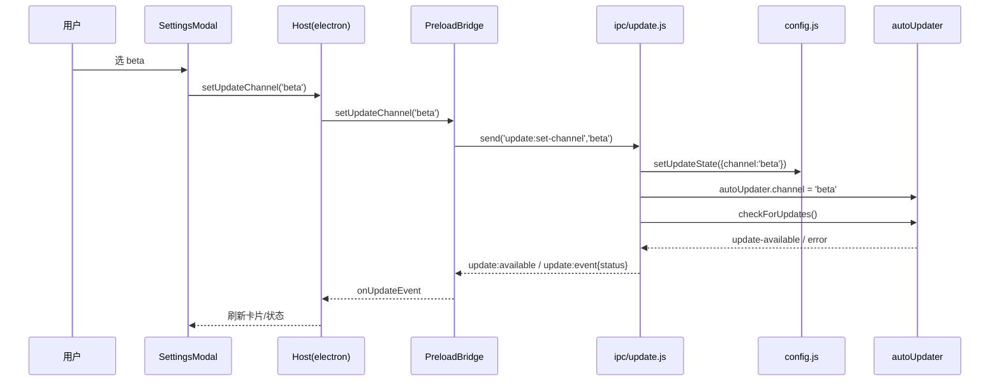
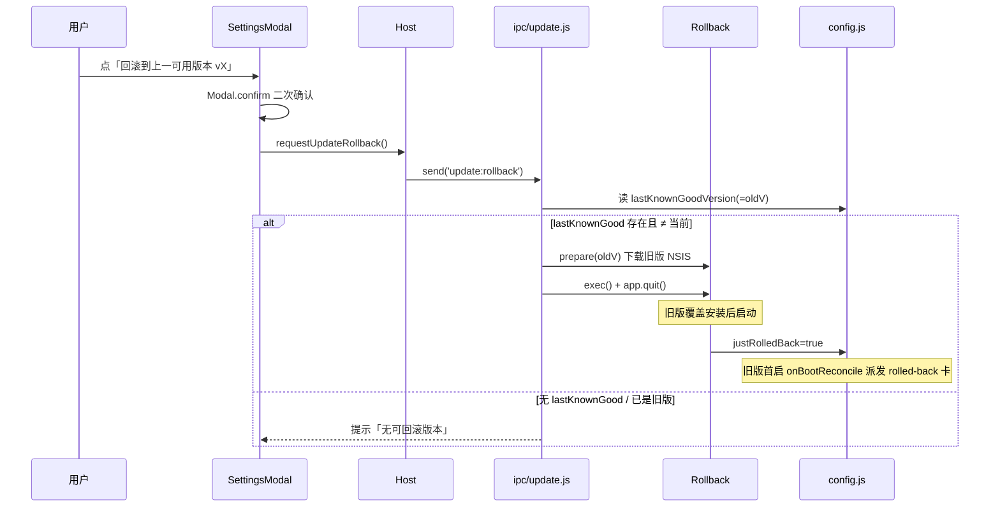
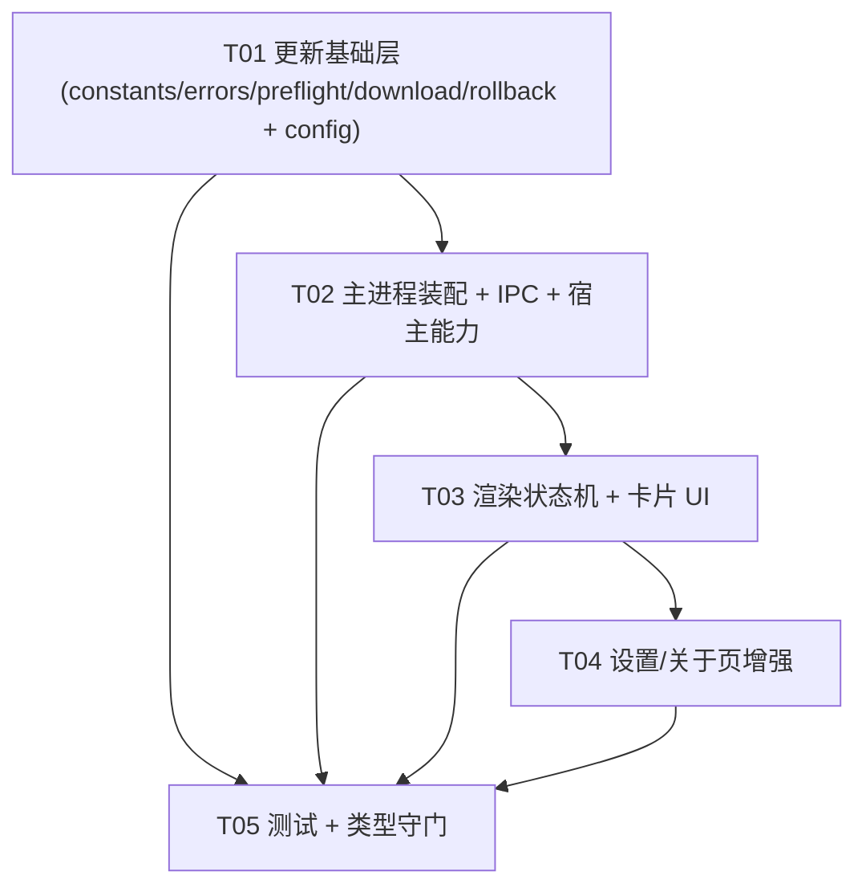

# AxHub 自动更新增强 · 系统架构设计 + 任务分解

> 文档作者：高见远（software-architect-2）
> 阅读对象：工程师（software-engineer / software-engineer-2）、QA（software-qa-engineer）、主理人
> 范围：**P0 必做**（更新渠道 / 静默安装健壮性 / 失败重试与回滚）；P1/P2 仅预留接口与说明，不在本次实现。
> 约束基线：Electron 33.4.11 主进程（Node.js，CJS）＋ Vue 3.5 渲染进程（ESM/Vite）＋ npm workspaces 单仓（desktop 根 / viewer 子包）。铁律见 CONTEXT.md / AGENTS.md——`.ts`/`.vue` 仅 UI 层；纯逻辑 `lib/`、`host/` 与宿主适配保持 `.js` 且零 Vue；渲染层禁直连 `window.axhub`/`localStorage`（经 `host/` 与 `user-data.js`）；配置持久化走 `user-store.js`+`user-keys.js`（渲染用户数据）与 `config.js`（主进程应用配置）；状态用 Pinia；import 用 `@/` 别名（vite.config.ts + tsconfig.json 双处一致）；`node --test` 测 `.js`，`vue-tsc --noEmit` 守门 `.ts`。

---

## 一、实现方案 + 框架选型

### 1.1 现状对齐（已 Read，未改）
- 主进程更新封装 `desktop/src/updater.js`：`setupAutoUpdater({autoUpdater})` 已做「启动 5s 静默检查 / 每 24h 复查 / 后台下载 / 进度发渲染层 / 下载完发 `update:ready` / 退出时 `autoInstallOnAppQuit`」。
- IPC 桥 `desktop/src/ipc/update.js`：`update:check`（handle）、`update:install`（on，直接 `quitAndInstall(false,true)`）、`update:set-silent`（on，落 `config.silentUpdate`）。
- 桥 `desktop/src/preload-bridge.js` 暴露 `version/checkUpdate/installUpdate/setSilentUpdate/onUpdateProgress/onUpdateAvailable/onUpdateReady`。
- 宿主 SPI `desktop/viewer/src/host/{index,electron,headless}.js`：`lookForUpdate/applyUpdate/setBackgroundDownload/onUpdateFound/onUpdateStaged/onDownloadProgress`。
- 渲染层更新 UI：`App.vue` 右下角内联「进度 toast + 就绪卡」；`SettingsModal.vue` 的「行为与更新」卡片含静默开关 + 检查更新按钮 + 关于区显示版本。
- 应用级配置 `desktop/src/config.js` 落盘 `userData/axhub-desktop.json`（含 `silentUpdate`、`dir`）。**注意**：`silentUpdate` 走的是主进程 `config.js`，不是 `user-keys.js`（渲染用户数据快照）。

### 1.2 框架选型（结论：尽量不新增依赖）
- **自动更新内核**：沿用 `electron-updater ^6.8.9`（已安装）。不新增任何第三方依赖。
- **渠道（channel）机制落地**：`autoUpdater.channel` 仅影响请求的 yaml 文件名——默认请求 `latest.yml`（= stable），设为 `'beta'` 后请求 `latest-beta.yml`。因此：
  - 启动时由主进程从 `config` 读取 `channel` 并 `autoUpdater.channel = channel`，**必须在首轮 `checkForUpdates()` 之前设定**（`updater.js` 现有 `setTimeout(checkSilently, 5000)` 前先 `applyChannel()`）。
  - 切换渠道 → 写 `config.channel` → `autoUpdater.channel = ch` → 立即 `checkForUpdates()`。
  - **CI 必须按渠道产出 `latest-beta.yml`**（Open Question Q1）——这是「部署前置条件」，不在本次代码范围，但 P0-1 验收「请求 `latest-beta.yml`」依赖它。若 CI 暂未产出，`autoUpdater` 对 beta 会报 `error`（no published version），主进程按现有 `error` 事件静默记日志 + 渲染层显示「检查失败」，不阻断。
- **静默安装健壮性**：preflight（磁盘空间 / 目录可写）属文件系统/OS 级检查，**放在主进程**（渲染层在此架构无直接 fs 能力，且安装动作本身 `quitAndInstall` 就在主进程）。安装前由主进程 `update:install` 处理器先跑 preflight，不通过则发 `update:event{type:'install-blocked'}` 给渲染层显示拦截卡；通过才 `quitAndInstall`。
- **失败可见 + 回滚**：安装/重启错误从「仅日志」升级为向渲染层发 `update:event{type:'install-failed'|'first-launch-failed'|'rolled-back'}`。首启异常回滚依赖「渲染层 UI 就绪信号 + 主进程 30s 看门狗 + 渲染进程崩溃事件」三重判定。
- **不新增依赖的理由**：退避重试用 `setTimeout` 自管；NSIS 退出码归因用 `mapInstallError()` 尽力映射；回滚用 `shell.openPath/spawn` + GitHub Releases 直链下载，均无需新包。

### 1.3 架构模式
- 主进程：**事件驱动 + 模块化解耦**（纯逻辑 `desktop/src/update/*.js` 零 Vue、可 `node --test`）。
- 渲染进程：**Pinia 单一更新状态机（`update.ts` store）+ `useHostSignals` 订阅宿主事件 + 复用现有 `host/` SPI**。UI 改动集中在 `UpdateCard.vue`（合并现有内联 toast/ready 卡）与 `SettingsModal.vue`。
- 跨进程：**IPC 事件多路复用**——新增的 P0 生命周期事件统一走 `update:event{type,payload}`（单一订阅 `onUpdateEvent`），避免 `host/index.js` 能力清单膨胀；既有 `update:progress/available/ready` 保持不变。

---

## 二、文件列表（相对路径）

| 类型 | 路径 | 语言/角色 | 说明 |
|---|---|---|---|
| 新建 | `desktop/src/update/constants.js` | `.js` 纯逻辑 | 渠道表、退避间隔、超时/空间阈值——**retry/backoff 常量单源** |
| 新建 | `desktop/src/update/errors.js` | `.js` 纯逻辑 | `FailureReason` 枚举 + `describe()` + `mapInstallError()`——**失败枚举单源** |
| 新建 | `desktop/src/update/preflight.js` | `.js` 纯逻辑 | 磁盘空间(≥300MB) + 安装目录可写校验，返回 `{ok,reason,detail}` |
| 新建 | `desktop/src/update/download.js` | `.js` 纯逻辑 | 下载失败指数退避重试状态机（30s→2min→5min，最多3次）+ 手动重试 |
| 新建 | `desktop/src/update/rollback.js` | `.js` 纯逻辑 | 从 GitHub Releases 按需拉取目标旧版 NSIS 安装包并执行（覆盖安装回旧版） |
| 修改 | `desktop/src/config.js` | `.js` | 新增 `getUpdateState()/setUpdateState(patch)`，命名空间 `update:{channel,lastKnownGoodVersion,pendingInstall,blockedVersion,justRolledBack}` |
| 修改 | `desktop/src/updater.js` | `.js` | 启动 `applyChannel()`；接入 `DownloadRetry`；`update:install` 前置 preflight；首启看门狗 + 崩溃回滚；发失败/回滚事件 |
| 修改 | `desktop/src/ipc/update.js` | `.js` | 新增 `update:set-channel` / `update:first-launch-ready` / `update:download-retry-now` / `update:rollback` / `update:status`（handle）；`update:install` 改走 preflight |
| 修改 | `desktop/src/app.js` | `.js` | 启动时 `onBootReconcile()`（pendingInstall 对账、justRolledBack 派发）；订阅 `webContents` 崩溃事件 |
| 修改 | `desktop/src/preload-bridge.js` | `.js` | 新增 `updateStatus/setUpdateChannel/requestUpdateRollback/onUpdateEvent` 桥方法 |
| 修改 | `desktop/viewer/src/host/electron.js` | `.js`（host 后端） | 映射 4 个新能力到桥 |
| 修改 | `desktop/viewer/src/host/index.js` | `.js`（SPI 注册） | `QUERIES` 增 `updateStatus`；`COMMANDS` 增 `setUpdateChannel`/`requestUpdateRollback`；`SUBSCRIPTIONS` 增 `onUpdateEvent` |
| 修改 | `desktop/viewer/src/host/headless.js` | `.js`（测试后端） | 新增能力桩（conformance 不破、降级安全） |
| 新建 | `desktop/viewer/src/stores/update.ts` | `.ts` Pinia | 更新状态机 phase + status(channel/lkg/version) + retry/rollback actions |
| 修改 | `desktop/viewer/src/composables/useHostSignals.ts` | `.ts` | 订阅 `onUpdateEvent`，向 `update` store 派发 blocked/failed/retry/rolledBack/status |
| 新建 | `desktop/viewer/src/components/update/UpdateCard.vue` | `.vue` | 合并进度/就绪/重试/拦截/失败/回滚卡片（取代 App.vue 内联 toast/ready） |
| 修改 | `desktop/viewer/src/App.vue` | `.vue` | 删除内联更新卡，改用 `UpdateCard` |
| 修改 | `desktop/viewer/src/components/modals/SettingsModal.vue` | `.vue` | 行为与更新区：渠道选择器 + 显示 channel/lkg + 手动回滚按钮（二次确认）；关于区同步 |
| 新建 | `desktop/viewer/src/components/common/ChannelSelect.vue` | `.vue` | 渠道下拉（stable/beta）复用组件 |
| 新建 | `desktop/viewer/src/lib/update-types.ts` | `.ts` 纯类型 | `UpdateStatus`/`UpdatePhase`/`UpdateEvent`/`FailureDescriptor` 类型，**无逻辑**（逻辑单源在主进程 `errors.js`，此处仅类型声明） |
| 新建 | `desktop/src/update/__tests__/errors.test.js` | `.js` `node --test` | `FailureReason` 枚举穷尽 + `mapInstallError` 映射 |
| 新建 | `desktop/src/update/__tests__/preflight.test.js` | `.js` `node --test` | 空间不足 / 只读目录 / 正常 三态（mock fs） |
| 新建 | `desktop/src/update/__tests__/download.test.js` | `.js` `node --test` | 退避时序（30s→2min→5min）+ 耗尽 + 手动重试 |
| 修改 | `desktop/viewer/test/host-conformance.test.js` | `.js` 测试 | 覆盖新增 4 能力（electron + headless 双后端） |

> 说明：`user-keys.js`（渲染用户数据快照键清单）**不登记**本次新增的更新状态字段——理由见 §三.1 决策说明。

---

## 三、数据结构与接口

### 3.1 配置字段 schema + key（关键决策：不进 `user-keys.js`）

新增的更新状态必须**由主进程在渲染层存在之前就读取/写入**（渠道启动即生效、lastKnownGood 启动即写、pendingInstall 安装后即写），因此它们落入**主进程 `config.js`（盘 `axhub-desktop.json`）的 `update` 命名空间**，而非 `user-keys.js`（后者仅登记 `wb_axhub_*` 渲染用户数据快照，且需经 preload 水合，启动早期不可用）。这是对「登记到 user-keys.js」指令的有意偏离，已在 §八 明确说明。

```js
// desktop/src/config.js 新增（其余 top-level 字段 silentUpdate/dir 保留）
function getUpdateState () {
  const c = loadConfig()
  return Object.assign({
    channel: 'stable',            // 'stable' | 'beta'
    lastKnownGoodVersion: '',     // 末次成功启动版本；空 → fallback 当前 VERSION
    pendingInstall: null,         // { newVersion, oldVersion, stagedAt } 待安装标记
    blockedVersion: null,         // 回滚后封锁的坏版本，避免重装循环
    justRolledBack: false         // 本次启动是回滚后的首启（用于派发 rolled-back）
  }, c.update || {})
}
function setUpdateState (patch) {
  const c = loadConfig()
  c.update = Object.assign(getUpdateState(), patch)
  fs.writeFileSync(CONFIG_PATH, JSON.stringify(c, null, 2))
}
```

渲染层显示渠道/lkg 通过宿主查询 `updateStatus()`（见 §3.3），**不**在 `user-data` 持久化；渠道切换由 UI 经 `host.setUpdateChannel(ch)` → 主进程落 `config.update.channel`。

### 3.2 失败原因枚举（单源：`desktop/src/update/errors.js`）

```js
const FailureReason = Object.freeze({
  DISK_SPACE:          'DISK_SPACE',          // 磁盘空间不足
  NO_WRITE_PERMISSION: 'NO_WRITE_PERMISSION', // 安装目录无写入权限
  FILE_IN_USE:         'FILE_IN_USE',         // 文件被占用（另一实例/Explorer 锁定）
  AV_BLOCKED:          'AV_BLOCKED',          // 被防病毒拦截
  UNKNOWN:             'UNKNOWN'              // 未知（附原始退出码）
})
// describe(reason) → { title, hint, action, canRetry }
// mapInstallError(err) → FailureReason（依据退出码/消息尽力归类，见 §八 Q4）
```
主进程在 IPC 事件中直接发送**人类可读的 `FailureDescriptor`**（title/hint/action/canRetry），渲染层只做展示——保证文案单源在 `errors.js`，渲染层无需自持枚举（仅 `update-types.ts` 做 TS 类型声明）。

### 3.3 主进程 ↔ 渲染进程 IPC 事件清单

**渲染层 → 主进程**
| 通道 | 类型 | 入参 | 说明 |
|---|---|---|---|
| `update:check` | handle（既有） | — | 手动检查；返回 `{ok,available,version,portable,error}` |
| `update:install` | on（改） | — | **先跑 preflight**，通过才 `quitAndInstall`；不通过发 `install-blocked` |
| `update:set-silent` | on（既有） | on | 静默下载开关 |
| `update:set-channel` | on（新） | channel | 设渠道 + 落 config + `autoUpdater.channel` + 立即 `checkForUpdates` |
| `update:first-launch-ready` | send（新） | — | 渲染层 UI 就绪信号（App.vue onMounted 发一次） |
| `update:download-retry-now` | send（新） | — | 退避耗尽后手动重试下载 |
| `update:rollback` | send（新） | — | 手动回滚（UI 已二次确认） |
| `update:status` | handle（新） | — | 返回 `{version,channel,lastKnownGood,portable}` |

> 注：本表 `update:first-launch-ready` / `update:download-retry-now` 两通道在渲染层侧经 host SPI 命令 `reportFirstLaunchReady()` / `retryDownloadNow()` 收发（见下方 host SPI 说明），渲染层不直连桥。

**主进程 → 渲染层**
| 通道 | payload | 说明 |
|---|---|---|
| `update:progress` | pct\|null（既有） | 下载进度 |
| `update:available` | `{version}`（既有） | 发现新版本 |
| `update:ready` | `{version}`（既有） | 下载完成可重启 |
| `update:event` | `{type,payload}`（新，多路复用） | 见下 |

`update:event.type` 取值：
- `status` → payload `{version,channel,lastKnownGood,portable}`（启动/变更时推送，供设置/关于对账）
- `install-blocked` → payload `FailureDescriptor`（preflight 不通过，不安装）
- `install-failed` → payload `FailureDescriptor`（`quitAndInstall` 抛错）
- `first-launch-failed` → payload `{oldVersion,reason}`（首启异常，将回滚）
- `download-retry` → payload `{attempt,max,nextInMs,error}`（退避重试中）
- `download-exhausted` → payload `FailureDescriptor`（3 次耗尽，给手动重试）
- `rolled-back` → payload `{oldVersion,reason}`（回滚后旧版首启派发）
- `rollback-failed` → payload `FailureDescriptor`（回滚失败，给手动入口）

**宿主 SPI（host/index.js）新增**
- `QUERIES`：`updateStatus`
- `COMMANDS`：`setUpdateChannel(channel)`、`requestUpdateRollback()`、**`reportFirstLaunchReady()`（对应 IPC `update:first-launch-ready`）**、**`retryDownloadNow()`（对应 IPC `update:download-retry-now`）**
- `SUBSCRIPTIONS`：`onUpdateEvent(cb)`（消费 `update:event`）
- 既有 `lookForUpdate/applyUpdate/setBackgroundDownload/onUpdateFound/onUpdateStaged/onDownloadProgress` 保留。

> **实现期修订（P0 落地时同步）**：渲染层→主进程的 `update:first-launch-ready` 与 `update:download-retry-now` 两个信号，出于铁律「渲染层禁直连 `window.axhub`」，**不**让渲染层绕过 host 直触桥，而是与 `applyUpdate`/`setUpdateChannel` 一致，登记为 SPI 命令 `reportFirstLaunchReady` / `retryDownloadNow`（electron.js 映射桥的 `firstLaunchReady`/`downloadRetryNow`，headless.js 补桩，conformance 覆盖）。故本节 SPI 实际新增为 4 能力 + 2 命令 = 6 项；原 §3.3 初稿仅列 4 项，此处补正。所有渲染层→主进程的更新通道一律经 host SPI 收发，渲染层不得直接调用桥方法。

### 3.4 类图（详见 `class-diagram.mermaid`）

```mermaid
classDiagram
    direction LR

    class Config {
        <<module: desktop/src/config.js>>
        +getUpdateState() UpdateState
        +setUpdateState(patch) void
    }
    class UpdateConstants {
        <<module: desktop/src/update/constants.js>>
        +CHANNELS: string[2]
        +MAX_RETRIES: 3
        +RETRY_DELAYS: number[3]
        +FIRST_LAUNCH_TIMEOUT_MS: 30000
        +MIN_DISK_FREE_MB: 300
    }
    class UpdateErrors {
        <<module: desktop/src/update/errors.js>>
        +FailureReason: enum
        +describe(reason) Descriptor
        +mapInstallError(err) FailureReason
    }
    class Preflight {
        <<module: desktop/src/update/preflight.js>>
        +check(opts) PreflightResult
    }
    class DownloadRetry {
        <<module: desktop/src/update/download.js>>
        -attempt: number
        -timer: Timeout
        +start(autoUpdater, onEvent) void
        +retryNow() void
        -scheduleNext() void
    }
    class Rollback {
        <<module: desktop/src/update/rollback.js>>
        +prepare(oldVersion, deps) Promise~void~
        +exec(installerPath, deps) void
    }
    class Updater {
        <<module: desktop/src/updater.js>>
        +setupAutoUpdater(deps) void
        -applyChannel() void
        -armFirstLaunchWatchdog() void
        -onBootReconcile() void
    }
    class UpdateIpc {
        <<module: desktop/src/ipc/update.js>>
        +register(ipcMain, c) void
    }
    class AppEntry {
        <<module: desktop/main.js + src/app.js>>
        +start(deps) void
    }
    class PreloadBridge {
        <<module: desktop/src/preload-bridge.js>>
        +buildBridge(ipcRenderer) Bridge
    }
    class ElectronHost {
        <<module: viewer/src/host/electron.js>>
        +createElectronHost(bridge) Host
    }
    class HeadlessHost {
        <<module: viewer/src/host/headless.js>>
    }
    class HostIndex {
        <<module: viewer/src/host/index.js>>
        +QUERIES / COMMANDS / SUBSCRIPTIONS
    }
    class UpdateStore {
        <<Pinia: viewer/src/stores/update.ts>>
        -phase: string
        -status: UpdateStatus
        -retry: RetryState
        +setChannel(ch) void
        +refreshStatus() void
        +installNow() void
        +manualRollback() void
        +retryDownload() void
    }
    class UseHostSignals {
        <<composable: viewer/src/composables/useHostSignals.ts>>
        +onUpdateEvent handler
    }
    class UpdateCard {
        <<Vue: viewer/src/components/update/UpdateCard.vue>>
    }
    class SettingsModal {
        <<Vue: viewer/src/components/modals/SettingsModal.vue>>
    }
    class ChannelSelect {
        <<Vue: viewer/src/components/common/ChannelSelect.vue>>
    }
    class App {
        <<Vue: viewer/src/App.vue>>
    }

    AppEntry --> Updater : wires
    AppEntry --> UpdateIpc : registers
    Updater --> Config : read/write channel,lkg
    Updater --> DownloadRetry : uses
    Updater --> Preflight : uses
    Updater --> Rollback : triggers
    Updater --> UpdateErrors : maps reasons
    UpdateIpc --> Config : set channel/silent
    UpdateIpc --> Preflight : install preflight
    UpdateIpc --> Rollback : manual/auto
    UpdateIpc --> UpdateErrors : describe
    Preflight ..> UpdateConstants : MIN_DISK_FREE_MB
    DownloadRetry ..> UpdateConstants : RETRY_DELAYS
    Updater ..> UpdateConstants : FIRST_LAUNCH_TIMEOUT_MS
    PreloadBridge --> UpdateIpc : IPC mapping
    ElectronHost --> PreloadBridge : consumes window.axhub
    HeadlessHost ..|> ElectronHost : conforms SPI
    HostIndex --> ElectronHost : registers caps
    UpdateStore --> ElectronHost : calls
    UseHostSignals --> UpdateStore : feeds events
    App --> UseHostSignals : uses
    App --> UpdateCard : renders
    SettingsModal --> ChannelSelect : embeds
    SettingsModal --> UpdateStore : reads/writes channel,lkg
    UpdateCard --> UpdateStore : reads phase
```



---

## 四、程序调用流程（关键时序）

### ④.1 渠道切换 → 设 channel → checkForUpdates



### ④.2 下载 → 退避重试 → 就绪 → preflight → 安装 → 重启 → 首启检查 → 异常回滚

```mermaid
sequenceDiagram
    participant AU as autoUpdater
    participant DR as DownloadRetry
    participant U as Updater
    participant R as Renderer(UpdateCard)
    participant PF as Preflight
    participant RB as Rollback
    participant C as config.js

    Note over AU,DR: 启动 5s 静默检查命中新版本
    AU->>DR: downloadUpdate() 失败
    DR->>DR: scheduleNext() 30s
    DR-->>R: update:event{download-retry, attempt:1}
    DR->>AU: downloadUpdate() 再失败（2min,5min）
    DR-->>R: download-retry ×3
    DR-->>R: update:event{download-exhausted}
    Note over R: 显示「更新失败」卡 + [重试]
    R->>DR: update:download-retry-now
    DR->>AU: downloadUpdate() 成功
    AU-->>U: update-downloaded
    U->>C: setUpdateState({pendingInstall:{newVersion,oldVersion}})
    U-->>R: update:ready{version}
    Note over R: 就绪卡 [立即重启安装]
    R->>U: update:install
    U->>PF: check()
    alt 不通过
        PF-->>R: update:event{install-blocked}
        Note over R: 拦截卡 + [重试][稍后]
    else 通过
        U->>AU: quitAndInstall(false,true)
        Note over U: 应用退出并安装
    end
    Note over U: 重启后 onBootReconcile：存在 pendingInstall=newVersion
    U->>U: armFirstLaunchWatchdog(30s)
    R->>U: update:first-launch-ready
    alt 30s 内收到就绪 且 无崩溃
        U->>C: lastKnownGood=newVersion; pendingInstall=null
    else 超时 / webContents crashed
        U->>RB: prepare(oldVersion) 下载旧版安装包
        U->>C: blockedVersion=newVersion; justRolledBack=true
        U->>RB: exec() + app.quit()
        RB-->>R: update:event{first-launch-failed}
    end
```

### ④.3 手动回滚路径（P0-9）



### ④.4 防重装循环（关键细节）
自动/手动回滚后，`blockedVersion` 置为坏版本。后续 `update:check` 与静默检查命中 `info.version === blockedVersion` 时，**不下载、返回 `available:false`**（UI 标注「vX 已因回滚被屏蔽，可手动解除」）。解除 = 用户手动点「仍要更新」→ 清 `blockedVersion` 后重新 `checkForUpdates`。

---

## 五、任务列表（有序、含依赖、按实现顺序）

> 遵循硬上限：**≤5 个任务、每任务 ≥3 文件、首任务为基础层**。本增强项目「基础设施」解释为「共享纯逻辑 + 配置 schema + 常量/枚举单源」（含 `package.json` 依赖核对）。

### T01 · 更新基础层（主进程纯逻辑 + 配置 schema + 常量/枚举单源） · P0
- **Source Files**：`desktop/src/update/constants.js`、`desktop/src/update/errors.js`、`desktop/src/update/preflight.js`、`desktop/src/update/download.js`、`desktop/src/update/rollback.js`、`desktop/src/config.js`、`desktop/package.json`
- **Dependencies**：无（基础层，其它任务全部依赖它）
- **Priority**：P0
- **要点**：实现 §三.1~3.2 的全部纯逻辑模块与常量/枚举单源；`package.json` 核对 `electron-updater ^6.8.9`（不新增依赖）；`config.js` 新增 `getUpdateState/setUpdateState`。`node --test` 可对 `.js` 直接单测。

### T02 · 主进程更新装配 + IPC 桥 + 宿主能力注册 · P0
- **Source Files**：`desktop/src/updater.js`、`desktop/src/ipc/update.js`、`desktop/src/app.js`、`desktop/src/preload-bridge.js`、`desktop/viewer/src/host/electron.js`、`desktop/viewer/src/host/index.js`、`desktop/viewer/src/host/headless.js`
- **Dependencies**：T01
- **Priority**：P0
- **要点**：`updater.js` 接入 `applyChannel`/`DownloadRetry`/preflight/首启看门狗/崩溃回滚；`ipc/update.js` 新增 `update:set-channel`/`update:first-launch-ready`/`update:download-retry-now`/`update:rollback`/`update:status`（handle），`update:install` 改走 preflight；`app.js` 启动 `onBootReconcile` + 订阅 `webContents` 崩溃；preload/host 三件套补齐 4 个新能力（含 `headless` 桩，conformance 不破）。

### T03 · 渲染层更新状态机 + 卡片 UI · P0
- **Source Files**：`desktop/viewer/src/stores/update.ts`、`desktop/viewer/src/composables/useHostSignals.ts`、`desktop/viewer/src/components/update/UpdateCard.vue`、`desktop/viewer/src/App.vue`
- **Dependencies**：T02
- **Priority**：P0
- **要点**：新建 Pinia `update` store（phase 状态机 + status + retry/rollback actions）；`useHostSignals` 订阅 `onUpdateEvent` 向 store 派发；`UpdateCard.vue` 合并进度/就绪/重试/拦截/失败/回滚六态卡片；`App.vue` 删除内联卡改用 `UpdateCard`。

### T04 · 设置页/关于页增强（渠道选择 + lkg + 手动回滚）· P0
- **Source Files**：`desktop/viewer/src/components/modals/SettingsModal.vue`、`desktop/viewer/src/components/common/ChannelSelect.vue`、`desktop/viewer/src/lib/update-types.ts`
- **Dependencies**：T03
- **Priority**：P0
- **要点**：`SettingsModal`「行为与更新」区加渠道选择器 + 显示 channel/lkg + 手动回滚按钮（二次确认）；关于区同步展示；抽出 `ChannelSelect.vue` 复用；`update-types.ts` 仅 TS 类型声明（逻辑单源在主进程）。

### T05 · 测试 + 类型守门 + 集成校验 · P0
- **Source Files**：`desktop/src/update/__tests__/errors.test.js`、`desktop/src/update/__tests__/preflight.test.js`、`desktop/src/update/__tests__/download.test.js`、`desktop/viewer/test/host-conformance.test.js`、`desktop/viewer/tsconfig.json`、`desktop/viewer/vite.config.ts`
- **Dependencies**：T01, T02, T03, T04
- **Priority**：P0
- **要点**：`node --test` 覆盖 `errors`（枚举穷尽 + `mapInstallError`）、`preflight`（空间/只读/正常三态 mock fs）、`download`（退避时序 + 耗尽 + 手动重试）；`host-conformance.test.js` 双后端覆盖 4 新能力；`vue-tsc --noEmit` 守门新增 `.ts`/`.vue`（确认 `@/` 别名在 `vite.config.ts` + `tsconfig.json` 双处一致，无需改动仅核对）。

### 任务依赖图



---

## 六、依赖包列表（仅新增/变更）

| 包 | 版本 | 变更 | 说明 |
|---|---|---|---|
| `electron-updater` | `^6.8.9` | 维持（已安装，建议在 `package.json` 锁定为 `^6.8.9` 以防漂移） | 渠道/下载/安装内核，无替代 |
| （无新增） | — | — | 退避重试、NSIS 归因、回滚下载均用 Node/Electron 原生 API，无需新包 |

> 明确**不引入** React/MUI（沿用现有 Vue 3 + Ant Design Vue 渲染层）。

---

## 七、共享知识（跨文件约定）

1. **失败枚举单源**：`desktop/src/update/errors.js` 的 `FailureReason` + `describe()` + `mapInstallError()`。渲染层**不**自持枚举值——主进程在 IPC 事件中直发可读 `FailureDescriptor`，`update-types.ts` 仅做 TS 类型声明。
2. **配置 key 单源**：主进程应用级更新状态统一经 `config.js` 的 `getUpdateState/setUpdateState`（命名空间 `update:`），**不**登记进 `user-keys.js`；渲染用户数据键清单仍只在 `user-keys.js`。
3. **更新状态机位置**：渲染层唯一状态机 = Pinia `update` store（`viewer/src/stores/update.ts`）；主进程侧为事件驱动（无独立状态机类，状态存 `config.update`）。两侧通过 `update:event` 多路复用同步。
4. **retry/backoff 常量位置**：`desktop/src/update/constants.js`（`RETRY_DELAYS=[30000,120000,300000]`、`MAX_RETRIES=3`、`FIRST_LAUNCH_TIMEOUT_MS=30000`、`MIN_DISK_FREE_MB=300`）。**任何改动只改此处**，主进程各模块 `import` 引用。
5. **IPC 事件命名纪律**：既有 `update:progress/available/ready` 不变；所有新增 P0 生命周期事件统一 `update:event{type,payload}`，渲染侧单一订阅 `onUpdateEvent`——禁止为每种失败再开独立 IPC 通道（避免 `host/index.js` 能力膨胀）。
6. **宿主 SPI 纪律**：新增能力必须先登记 `host/index.js` 的 `QUERIES/COMMANDS/SUBSCRIPTIONS` + 在 `electron.js` 映射 + 在 `headless.js` 补齐桩（conformance 同用例双后端跑），否则业务层 `supports()` 拿不到会静默降级。
7. **portable 处理**：`portable` 标志经 `updateStatus().portable` 下发；portable 不支持 `applyUpdate/requestUpdateRollback`，UI 据 `supports()` 隐藏渠道/回滚/安装按钮，维持现状「去 Releases 页下载」指引。
8. **测试守门**：`.js` 纯逻辑用 `node --test`（桌面根 `npm test`）；`.ts`/`.vue` 用 `vue-tsc --noEmit`（`npm run type-check --workspace viewer`）。新增纯逻辑必须带测试。

---

## 八、待明确事项（Open Questions 决策建议）

**Q1 · beta 渠道发布链路** —— **作为「部署前置条件」单列，不在本次代码范围。**
`autoUpdater.channel='beta'` 仅改变请求文件名（`latest-beta.yml`）。CI 必须由 owner `xianyu21`/repo `ol-workbench` 在发 beta 预发布时额外产出 `latest-beta.yml` + beta NSIS 资源。代码侧已做好消费：切 beta 即请求该 yaml；若暂未产出，`update:error` 会记日志 + 渲染层显示「检查失败」，不阻断。建议主理人开一个独立部署任务跟踪 CI 改动。

**Q2 · 回滚可行性 / 缓存策略** —— **P0 不缓存旧安装包到本地。**
决策：回滚采用「按需从 GitHub Releases 下载目标旧版 NSIS 安装包并执行（覆盖安装回旧版本）」。理由：① NSIS 安装后运行期不保留 installer 文件，预缓存需额外下载且常驻 ~100–200MB 不可接受；② 旧版本本就发布在 Releases（更新来源同源），下载即可，无需预存；③ 复杂度低、零常驻体积。本地缓存旧安装包改为 **P1-4 可选增强**（离线回滚场景）。**体积结论：P0 零常驻占用，可接受。**

**Q3 · 首次启动异常判定阈值** —— **取「未处理异常 + 启动超时」，阈值 30s；多重缓解误回滚。**
决策：触发条件 = `update:first-launch-ready` 在 **`FIRST_LAUNCH_TIMEOUT_MS=30000`** 内未到达 **或** `webContents`/`app` 渲染进程崩溃事件。`first-launch-pending` 标记存在时才启用看门狗（常态启动不监控）；30s 远大于正常 UI 就绪（<3s）；回滚前设 `blockedVersion` 防重装循环；自动回滚失败（无网络取不到旧包）降级为「失败卡 + 手动入口」而非卡死。阈值留 `constants.js` 单源可调。

**Q4 · 安装失败归因精度** —— **接受「尽力归类 + 通用指引」，不追求 100% 精确。**
决策：`mapInstallError(err)` 按可观测信号优先级映射：空间→`DISK_SPACE`（preflight 已前置拦截，安装期再报为辅）；写入/权限失败→`NO_WRITE_PERMISSION`；另一实例/Explorer 锁定→`FILE_IN_USE`；防病毒拦截（退出码非 0 + 目标文件缺失/被锁）→`AV_BLOCKED`；其余→`UNKNOWN`（附原始退出码）。preflight 已过滤大部分可预见权限/空间问题，故安装期归因只需「尽力 + 针对性操作建议」。

**Q5 · 静默下载失败可感知程度** —— 重试期间保持角落卡，但显示「重试中（第 n/3 次）」（经 `update:event{download-retry}`），不升级弹窗；企业代理下退避重试不受限（沿用系统代理）。「仅 Wi-Fi 下载」归入 P2-4。

**Q6 · 适用范围** —— **增强仅针对 NSIS 安装版；portable 维持现状、不纳入。** 经 `updateStatus().portable` + `host.supports()` 在能力层降级，UI 隐藏渠道选择/回滚/安装按钮，便携版继续走「去 Releases 页下载」指引。

**Q7 · 渠道 × 静默默认组合** —— **切到 beta 不强制改变静默下载/自动安装默认值，沿用用户既有设置。** beta 仅改变渠道，不改变安装激进程度（仍「后台静默下载 + 退出时自动安装」，不默认强制立即安装）。理由：避免 beta 用户被频繁打断，尊重既有静默策略；如需调整再据数据决定。

---

## 九、设计权衡与风险

- **回滚依赖网络**：P0 回滚需从 Releases 下载旧包，离线环境回滚失败→降级为失败卡+手动入口（不卡死）。这是 Q2 取舍的已知代价，P1-4 缓存可补离线场景。
- **重装循环防护**：`blockedVersion` 是关键防呆设计，必须在 `update:check`/静默检查两处都拦截，否则回滚后会再次拉新版本重蹈覆辙。
- **首启看门狗仅对更新后首启生效**，常态启动不监控，避免对慢机器/插件加载误伤（呼应 Q3）。
- **`config.update` 与既有 `silentUpdate` 共存**：`silentUpdate` 维持 top-level 不改，新字段入 `update` 命名空间，降低改动面与回归风险。
- **零新增依赖**：全程不引新包，回滚下载用 `https.get` + `shell.openPath/spawn`，退避用 `setTimeout`，归因用退出码字符串匹配。
- **可测试性**：所有纯逻辑（constants/errors/preflight/download/rollback）零 Vue、零 electron 硬依赖（经 `ctx.deps` 注入），可直接 `node --test`，符合铁律。
